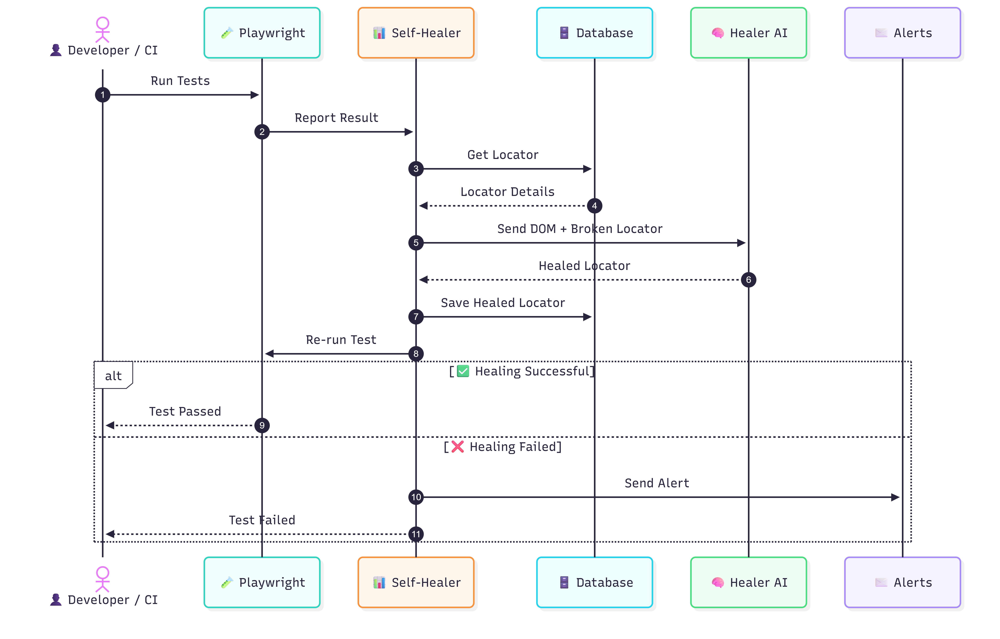
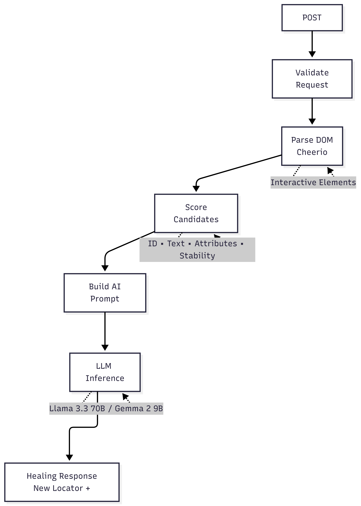

\# 🧠 Self Healer AI (`self-healer-ai`)


**Self Healer AI** (`self-healer-ai`) is an independent, high-performance microservice designed to provide automated, AI-driven locator healing for end-to-end web automation frameworks running with [**`self-healer`**](https://github.com/Nagarajukasarla/self-healer) and [Playwright](https://playwright.dev/). 

When UI updates break test locators, `self-healer-ai` receives the failed test context from [**`self-healer`**](https://github.com/Nagarajukasarla/self-healer), parses the current page DOM, ranks potential candidate elements using a heuristic scoring engine, and invokes an LLM agent powered by Groq and `@google/adk` to infer and return a resilient replacement CSS or XPath locator back to the caller.

---

## 🔄 End-to-End Self-Healing Workflow

`self-healer-ai` serves as the AI backend service connected with [**`self-healer`**](https://github.com/Nagarajukasarla/self-healer). Below is the complete sequence of events during test execution and automated healing:



---

## 🏗️ Architecture & Internal Pipeline

`self-healer-ai` executes a multi-stage pipeline to repair locators efficiently while keeping LLM token usage low:



1. **Fastify Server & Zod Validation**: Receives and validates incoming HTTP requests (`/heal`).
2. **Cheerio DOM Parser**: Fast, memory-efficient HTML parser extracting interactable HTML elements (`button`, `a`, `input`, `select`, `textarea`, `[data-testid]`, `[data-cy]`, `[role]`, `[name]`, `[id]`).
3. **Scorer Engine**: Evaluates DOM candidates using weighted rules (exact/partial text match, stable testing attributes like `data-testid`, exact/partial ID match, tag similarity, class stability).
4. **AI Agent Orchestrator**: Takes top scored candidates and failure metadata to formulate a focused structured prompt.
5. **Groq LLM Service**: Generates a precise replacement CSS or XPath selector with confidence scores and reasoning.

---

## ✨ Features

- ⚡ **Lightning Fast Fastify Server**: Low-latency REST API built on Fastify 5.
- 🎯 **Smart Candidate Scoring**: Pre-filters raw page HTML into candidate elements to minimize prompt size and maximize model accuracy.
- 🤖 **Groq LLM Acceleration**: Employs Groq's high-speed inference engine (`llama-3.3-70b-versatile` / `gemma2-9b-it`) and Google ADK agent primitives.
- 🛡️ **Attribute-First Locators**: Generates resilient locators prioritizing `data-testid`, `data-cy`, `id`, `name`, and `role` over dynamic classes or volatile XPath structures.
- 🐳 **Docker Ready**: Includes production-grade Docker container configuration.
- 🛠️ **Standalone SDK & Direct Service**: Easy to embed or consume as a standard node module or REST API.

---

## 🚀 Getting Started

### Prerequisites

- **Node.js**: `>= 22.0.0`
- **pnpm**: `>= 11.0.0`
- **Groq API Key**: Obtainable from [Groq Console](https://console.groq.com/).

### Installation

1. Clone the repository:
   ```bash
   git clone https://github.com/Nagarajukasarla/self-healer-ai.git
   cd self-healer-ai
   ```

2. Install dependencies with `pnpm`:
   ```bash
   pnpm install
   ```

### Environment Configuration

Create a `.env` file in the root directory (or copy `.env.example`):

```env
GROQ_API_KEY=your_groq_api_key_here
GROQ_MODEL=gemma2-9b-it
PORT=3001
HOST=0.0.0.0
```

---

## 💻 Running the Service

### Development Mode
Starts the service with live reloading using `tsx watch`:
```bash
pnpm dev
```

### Production Mode
Executes the service in production mode:
```bash
pnpm start
```

### Linting & Type Checking
Runs TypeScript checks and ESLint:
```bash
pnpm lint
```

---

## 🐳 Docker Deployment

You can containerize and deploy `self-healer-ai` using Docker:

### Build Docker Image
```bash
docker build -t self-healer-ai .
```

### Run Docker Container
```bash
docker run -d \
  -p 3001:3001 \
  --name self-healer-ai-service \
  --env-file .env \
  self-healer-ai
```

---

## 📡 API Reference

### 1. Health Check

Checks if the server and LLM configuration are operational.

- **Endpoint**: `GET /health`
- **Response**: `200 OK`
  ```json
  {
    "status": "ok",
    "timestamp": "2026-09-05T19:26:23.000Z",
    "service": "self-healer-ai"
  }
  ```

---

### 2. Heal Locator

Main endpoint to analyze page source and repair a broken locator.

- **Endpoint**: `POST /heal`
- **Headers**: `Content-Type: application/json`

#### Request Payload (`HealingRequest`)

```json
{
  "test": {
    "id": "test_login_01",
    "title": "User login failure test",
    "fullName": "Authentication > User login failure test",
    "file": "tests/auth/login.spec.ts",
    "line": 42,
    "column": 12,
    "status": "failed",
    "duration": 1520,
    "errors": [
      {
        "message": "Error: locator.click: Target page, context or browser has been closed",
        "stack": "Error: locator.click..."
      }
    ]
  },
  "failedLocator": {
    "type": "css",
    "value": "#submit-btn-old"
  },
  "locatorMetaData": {
    "submitBtn": {
      "text": "Sign In",
      "attributes": {
        "type": "submit",
        "class": "btn btn-primary"
      }
    }
  },
  "pageUrl": "https://example.com/login",
  "pageSource": "<html><body><form><button id=\"signin-btn-new\" data-testid=\"submit-btn\" type=\"submit\" class=\"btn btn-primary\">Sign In</button></form></body></html>"
}
```

#### Response Payload (`HealingResponse`)

```json
{
  "type": "css",
  "newLocator": "[data-testid=\"submit-btn\"]",
  "confidence": 0.95,
  "strategy": "Matched by stable testing attribute data-testid and button text 'Sign In'"
}
```

---

## Integration & Interlinking with [`self-healer`](https://github.com/Nagarajukasarla/self-healer)

`self-healer-ai` is directly connected with the [**`self-healer`**](https://github.com/Nagarajukasarla/self-healer) Playwright test reporter and automation framework.

### How They Work Together:

1. **Connection & Trigger**: `self-healer-ai` runs as a standalone HTTP microservice on port `3001` waiting for requests from [**`self-healer`**](https://github.com/Nagarajukasarla/self-healer).
2. **Healing Request Initiation**: When a Playwright test encounters a broken locator, [**`self-healer`**](https://github.com/Nagarajukasarla/self-healer) catches the failure, collects the DOM HTML snippet, failed locator details, and metadata, and calls `POST /heal` on `self-healer-ai`.
3. **Healing Process**: Upon receiving the request, `self-healer-ai` starts the healing workflow: DOM parsing, candidate scoring, and Groq LLM inference.
4. **Return to Caller**: Once healed, `self-healer-ai` sends the healed locator response back to the caller ([**`self-healer`**](https://github.com/Nagarajukasarla/self-healer)).
5. **Test Re-run**: `self-healer` saves the healed locator to its database and automatically re-runs the Playwright test.

---

## 📜 License

This project is licensed under the [ISC License](LICENSE).
